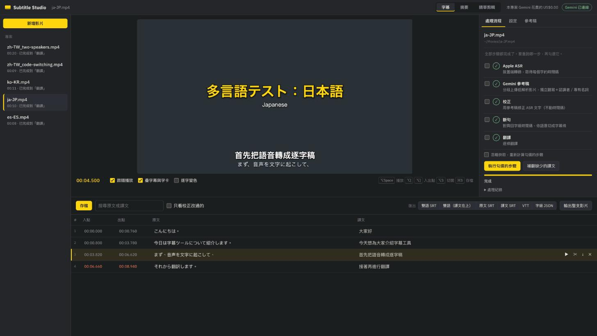
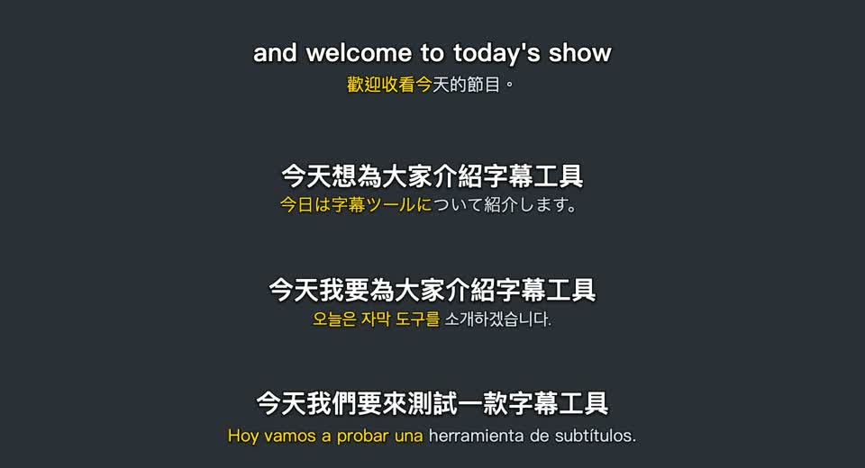

# Subtitle Studio



**English** — A local, browser-based subtitle workstation for macOS. Apple's on-device speech recognition gives every
word a timestamp; Google Gemini watches the video to write an independent reference transcript, corrects the
recognition errors, splits lines the way a subtitler would and translates them. Edit subtitles against the picture,
export SRT / VTT or the whole video with subtitles (soft track or burned in), get a summary, and cut highlight reels
by describing what you want — previewed live, non-destructively, before anything is rendered. Tested with English,
Chinese, Japanese, Korean and Spanish. Requires an Apple Silicon Mac on macOS 26+, ffmpeg and your own Gemini API
key. The interface is in Traditional Chinese.

---

本機 web GUI 字幕工作台：**Apple 裝置端 ASR 取得字級時間碼 → Gemini 看影片做獨立參考稿 → 校正文字 → 斷句 → 翻譯**，並能在瀏覽器裡對著影片逐條修字幕、匯出 SRT／VTT；字幕完成後還能產生**影片摘要**，以及依你指定的主題**剪出精華短片**（章節字卡、跳剪、雙語字幕）。

兩個設計原則：

- **時間碼只來自 Apple。** `SpeechTranscriber` 給每個字的時間範圍，Gemini 只改文字、不碰時間。
- **參考稿要獨立。** Gemini 看影片聽寫時看不到 ASR 文字，這樣兩邊不會互相帶偏，同音字、專有名詞的錯誤才抓得出來。

## 多語言

Apple 語音辨識支援的語言都能用（英、中〔台灣／中國／香港／粵語〕、日、韓、西、法、德、義、葡與多種印度語言；完整清單見 `bin/apple-asr --list-locales`），翻譯目標語言不限。

用 macOS 語音合成產生的測試片（`tests/make_multilingual_clips.py`，內容是自己寫的稿子）實測：

| 測試片 | 翻譯成 | Apple 辨識錯誤率 | Gemini 校正後 |
|---|---|---|---|
| 繁體中文（兩人對話） | 英文 | 25.6% | 3.7% |
| 日文 | 繁體中文 | 0% | 0% |
| 韓文 | 繁體中文 | 14.6% | 0% |
| 西班牙文 | 繁體中文 | 6.0% | 0% |
| 中英夾雜 | 英文 | 64.9% | 15.8% |



- 字型依每一行的文字自動選：日文用冬青黑體（Hiragino），韓文用 Apple SD Gothic Neo，中文依專案語言用蘋方繁／簡／港。
- 韓文保留詞間空格；中文、日文不加多餘空格。
- 「中英數之間加半形空格」只套用在中文。
- 翻譯風格留空時依目標語言自動決定（繁體中文用台灣用語）。
- **中英夾雜是弱點**：Apple 一次只能用一種語言辨識，英文詞會被聽成怪字，要靠 Gemini 修回；專有名詞（例如產品名）請放進詞彙表，否則可能被改錯。

## 需求

- Apple Silicon Mac，**macOS 26+**（`SpeechTranscriber` / `SpeechAnalyzer`）
- Swift toolchain（Xcode 或 Command Line Tools 皆可，只用 Speech／AVFoundation，不需 SwiftUI）
- `ffmpeg`／`ffprobe`（`brew install ffmpeg`）
- Python 3.10+（只用標準函式庫，免裝套件）
- Gemini API key（[Google AI Studio](https://aistudio.google.com/apikey)）。**費用由你的 Gemini 帳號支付，建議先在 [AI Studio](https://aistudio.google.com/spend) 設好每月花費上限。**

## 安裝與啟動

```bash
./setup.sh          # 編譯 bin/apple-asr 與 bin/text-render、從 .env.example 建立 .env
# 編輯 .env：GEMINI_API_KEY=...
./run.sh            # 啟動伺服器並開啟 http://127.0.0.1:8765（PORT=xxxx ./run.sh 可換埠）
```

第一次用某個語言時，macOS 會自動下載對應的語音模型。

## 使用

1. 「＋ 新增影片」：輸入路徑或按「瀏覽…」（直接讀原檔、不複製），也可以把檔案拖曳上傳（會複製到 `uploads/`）。
2. 選 ASR 語言，填「影片脈絡」（誰、什麼節目）和「詞彙表」（人名、品牌、術語）。這兩項能明顯提升人名與專有名詞的準確度。
3. 建立後會自動跑完整流程，右側面板顯示進度、log 與 Gemini 花費。
4. 在下方字幕表直接修改，存檔後匯出。

### 不開 GUI

```bash
python3 -m studio.cli <video> --opt locale=en-US --opt 'context=…' --opt 'glossary=…'
python3 -m studio.cli --project <id> --stages cues,translate      # 重跑部分步驟
```

## 流程

| 步驟 | 內容 | 產物（`projects/<id>/`） |
|---|---|---|
| **asr** | ffmpeg 抽 16 kHz 單聲道音軌 → `bin/apple-asr`（SpeechTranscriber，字級時間碼） | `audio.wav`, `asr.json` |
| **reference** | 依「每段分鐘數」切成 360p／2 fps 的代理檔，用 File API 上傳；Gemini 逐字聽寫，並標出講者與專有名詞（3 段並行） | `reference/chunk_*.json`, `reference.json` |
| **correct** | 把 ASR 段落和同時段的參考稿一起交給 Gemini（純文字）校正；段落中途換講者時標 `\|\|` | `corrected.json` |
| **cues** | 以 60 段為一個視窗，用 difflib 把校正後的文字對回 ASR 字級時間；再把影片片段和編號字詞交給 Gemini，由它看畫面、聽聲音決定每行字幕的斷點（語意斷句） | `cues.json` |
| **translate** | 以完整句子為單位交給 Gemini（JSON 格式），先翻整句再分配回每一條；每條附原文開頭供對位檢查，對不上就自動重翻 | `cues.json` 的 `tr` |

每步都有快取，可以單獨重跑；勾選「強制重算」會忽略快取。

### 對齊細節

- 字相同、或一對一替換的字，沿用 ASR 原本的時間；多出或缺少的字，在對應的 ASR 區間或空隙內依字數分配時間。
- 用視窗而不是逐段對齊，是因為 LLM 偶爾會把字搬到相鄰段落，即使 prompt 禁止。整個視窗一起比對，被搬走的字仍會落回正確的時間點。
- 語意斷句：每段約「每段分鐘數」長，切在最長的停頓上，不會切斷句子；Gemini 只拿到「一行大約幾個字元好讀」這個參考，其餘照說話的節奏、停頓與語意自行判斷。關掉 `semantic_breaks` 或 Gemini 失敗時，改用規則斷句（標點、停頓、長度）。

## 摘要與精華剪輯（字幕完成後）

**摘要**分頁：Gemini 讀整份字幕，產生標題、一句話簡介、摘要、帶時間碼的章節、重點、金句（原文＋譯文）和社群貼文。點時間碼可以跳到影片該處；可下載 Markdown，或一鍵複製 YouTube 章節格式。

**精華剪輯**分頁（非破壞性剪輯，跟一般剪輯軟體一樣：先預覽、確認後才輸出）：
1. 輸入想剪的內容（例如「他解釋技術原理的段落」，留空就由 AI 挑最精彩的）和目標秒數，選擇是否分章節、開頭放 hook、跳剪時放大。
2. 字幕先合併成完整句子（並標上講者）交給 Gemini 挑選，所以每段都從句子開頭開始、在句子結尾結束；預設再把初稿剪成低解析粗剪，請 Gemini 像剪輯師一樣「看粗剪」複查（語氣、表情、接點是否突兀、有沒有講完），同時附上每段前後各 18 秒的前後文影片，讓它延伸或替換段落時也看得到實際講法，修正後仍以句子編號回傳，精準剪點由字級時間碼與聲音音量計算。產生**剪輯企劃**，上方播放器直接停在第一個鏡頭。剪點落在兩句之間停頓**最安靜的那一刻**（依聲音音量），不會切到相鄰的字；講者完全沒停頓的接點會標「⚠ 接點沒有停頓」。每段可用「＋／－前一句」「＋／－後一句」微調，也能按每一句前面的 ✕ 單獨拿掉一句（在中間就自動變成跳剪），章節可用「＋ 在播放點加一段」補進你自己找到的段落。
3. 按「▶ 預覽」進入剪輯預覽模式：上方播放器換成**精華自己的時間軸**（例如 01:39，標出各章位置），播放、拖曳都只在精華內，並**即時合成**：章節字卡（含模糊底）、左上標籤、跳剪放大、雙語字幕與逐字變色都是當場疊上去的，沒有燒進任何東西。
4. 在企劃裡可以改章節標題、入／出點、順序，也能**直接改每一句字幕的原文和譯文**（會存回專案字幕），改完預覽立刻反映。
5. 確認後選字幕方式再「輸出影片」：**燒進畫面**（含逐字變色）、**內嵌字幕軌**（播放器可開關、之後可再編輯），或**不加字幕**（另附 SRT）。

預覽與輸出一致：字幕、字卡、標籤都由同一支 `bin/text-render`（Swift／AppKit，系統字型蘋方）畫成透明 PNG，預覽時由伺服器即時產生（有快取），輸出時由 ffmpeg 疊上影片，所以預覽看到的就是成品的字。唯一的差別是字卡的模糊底在預覽時用瀏覽器濾鏡近似，以及影片壓縮造成的輕微邊緣柔化。一般的 `brew install ffmpeg` 就夠，有 `h264_videotoolbox` 時用 Apple 硬體編碼。

## 中文排版規則

中文字幕（譯文，以及中文原文）會自動在中文與英文字母／數字之間加半形空格，例如「我54歲，在AI公司」→「我 54 歲，在 AI 公司」；翻譯完成、網頁存檔、匯出時都會套用，可在設定關閉（`cjk_spacing`）。

## 編輯器

| 操作 | 方式 |
|---|---|
| 播放／暫停 | ⌥Space |
| 把目前字幕的入點／出點設成播放點 | ⌥[ / ⌥] |
| 在播放點切開 | ⌥S（有字級時間時會精確切在字與字之間） |
| 前後跳 2 秒 | ⌥← / ⌥→ |
| 存檔 | ⌘S |
| 跳到某條 | 點 # 欄或 ▶ |

- ✎ 標記表示這條校正後與 ASR 不同，下方會顯示 ASR 原文；勾「只看校正有改的」可以集中檢查。
- 「補翻缺譯」只翻譯還沒有譯文的字幕條（例如手動切開、合併之後）。
- 重跑「斷句」會覆蓋手動修改；原文沒變的字幕條，舊譯文會自動沿用。

## 匯出

雙語 SRT（原文在上或譯文在上）、原文 SRT、譯文 SRT、VTT、字級 JSON（含每個字的時間）。

**輸出整支影片**（字幕分頁的「輸出整支影片」）：
- **內嵌字幕軌**：影音直接複製、不重新編碼（一小時的影片幾秒完成），播放器可開關字幕。
- **燒進畫面**：樣式與預覽相同，可選逐字變色；需要重新編碼。
- 輸出檔在 `projects/<專案>/exports/`，維持原片幀率。

## 設定（每個專案各自保存）

| 選項 | 預設 | 說明 |
|---|---|---|
| `locale` | `en-US` | ASR 語言（支援清單見 `bin/apple-asr --list-locales`） |
| `ref_model` | `gemini-flash-latest` | 看影片的模型；`gemini-pro-latest` 更準、較貴 |
| `text_model` | `gemini-flash-latest` | 校正與翻譯用的模型 |
| `chunk_minutes` | 10 | 參考稿每段長度 |
| `drop_fillers` | true | 移除 um／uh／嗯／呃 |
| `semantic_breaks` / `seg_thinking` | true / low | 語意斷句開關與 Gemini 思考程度（low／medium／high） |
| `max_chars` / `max_duration` / `gap_break` | 0（自動）/ 6.5 / 0.7 | 一行好讀的長度參考，以及規則斷句的參數 |
| `target_lang` / `translate_style` | 繁體中文（台灣）／（自動） | 翻譯目標語言；風格留空時依目標語言自動決定 |
| `karaoke` / `sub_order` | false / 譯文在上 | 逐字變色、雙語上下順序（預覽與輸出共用） |
| `correct_with_audio` / `energy_snap` / `backchannels` | true / true / 省略 | 校正時聽音訊、依音量校正字的邊界、附和（mm-hmm）怎麼處理 |

## 花費參考

以一部 58 分鐘的英文訪談實測：Gemini Flash 跑完整流程約 US$1、約 10 分鐘（ASR 1 分鐘、參考稿 3 分鐘、校正 2.5 分鐘、語意斷句 2 分鐘、翻譯 2 分鐘）。實際花費依模型價格與影片內容而定。GUI 右上角會顯示估算花費。

## 測試

```bash
python3 -m unittest discover -s tests -t . -v
```

- **單元測試**（純 Python、免網路）：多語言斷詞與排版、對齊、顯示時間、逐字變色、精華剪點、翻譯對位檢查等。GitHub Actions 每次 push 自動執行。
- **Mac 端到端測試**：用 macOS 語音合成念一段已知稿子 → Apple 語音辨識 → 對齊 → 斷句 → 匯出，不需要網路與 Gemini；在非 Mac 環境會自動略過。
- **多語言測試片**：`python3 tests/make_multilingual_clips.py` 會在 `uploads/testclips/` 產生 5 支測試影片和對照用的稿子（`manifest.json`），可以拿來跑完整流程。

## 專案結構

```
asr/main.swift        Apple SpeechTranscriber CLI → 字級時間 JSON（stderr 回報進度）
render/main.swift     字幕／章節字卡／標籤 → 透明 PNG（系統字型）
studio/pipeline.py    各步驟、對齊、斷句、匯出
studio/highlights.py  摘要、精華剪輯企劃、精華影片輸出
studio/gemini.py      Gemini REST（File API 上傳、JSON schema 輸出、遇暫時性錯誤時換模型）
studio/server.py      標準函式庫 HTTP server（API、支援 Range 的影片串流、背景執行）
studio/cli.py         無介面執行
static/               單頁前端（原生 JS）
tests/                單元測試、Mac 端到端測試、多語言測試片產生器
```

## 已知限制

- Gemini 偶爾不完全遵守「逐字」規則（例如把 gonna 改成 going to），或聽錯少數字；建議用「只看校正有改的」快速檢查一遍。
- 參考稿的講者標籤是每段各自判斷的，偶爾會不一致，只影響換講者時的斷句。
- 伺服器只綁 `127.0.0.1`，不做身分驗證，請不要對外開放。
- 只能在 Apple Silicon Mac、macOS 26 以上使用（依賴 Apple 裝置端語音辨識）；介面只有中文。
- 字幕交付規範還沒完整實作：譯文長度與換行、閱讀速度（每秒字數）、對齊影格、鏡頭切換偵測。
- 由右往左的語言（阿拉伯文、烏爾都文）沒有特別處理，雙人字幕的破折號位置可能不對。
- 精華影片沒有響度標準化，也還沒有直式（9:16）輸出與 FCPXML／EDL 匯出。

## 授權

[MIT](LICENSE)
